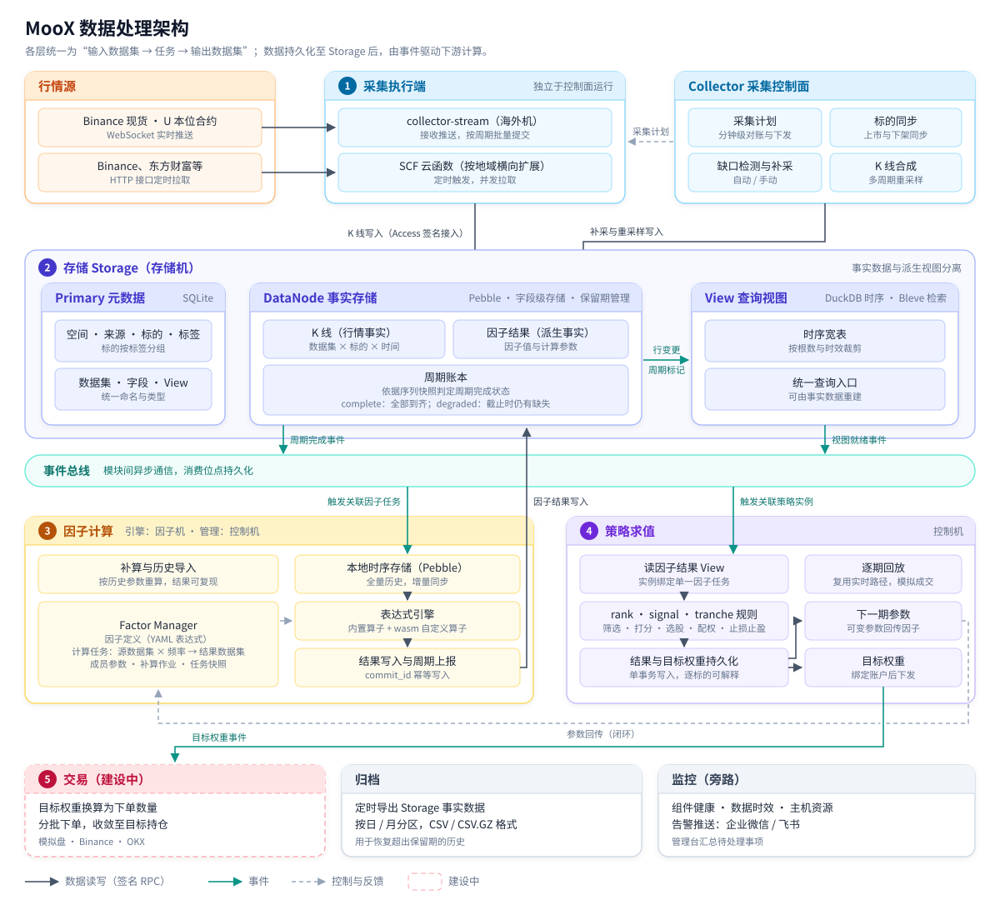
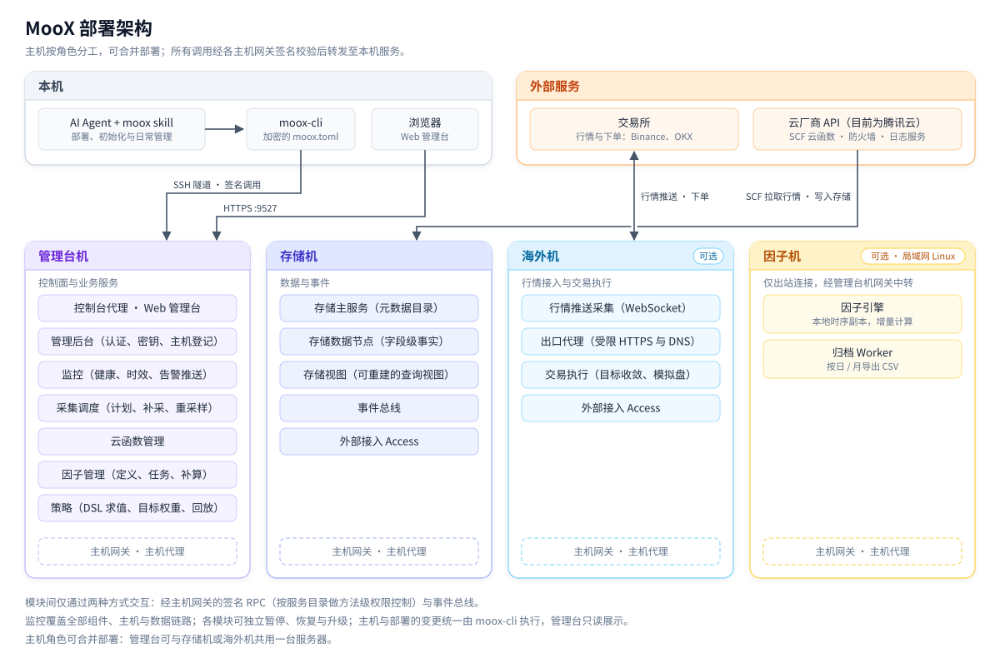
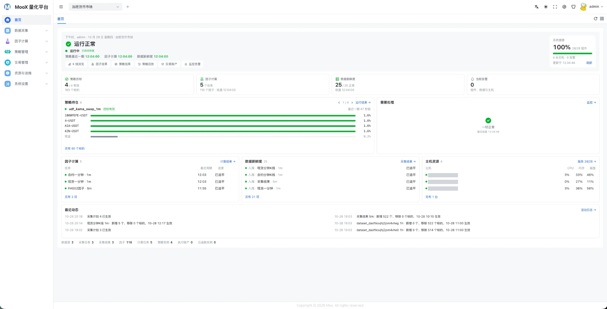
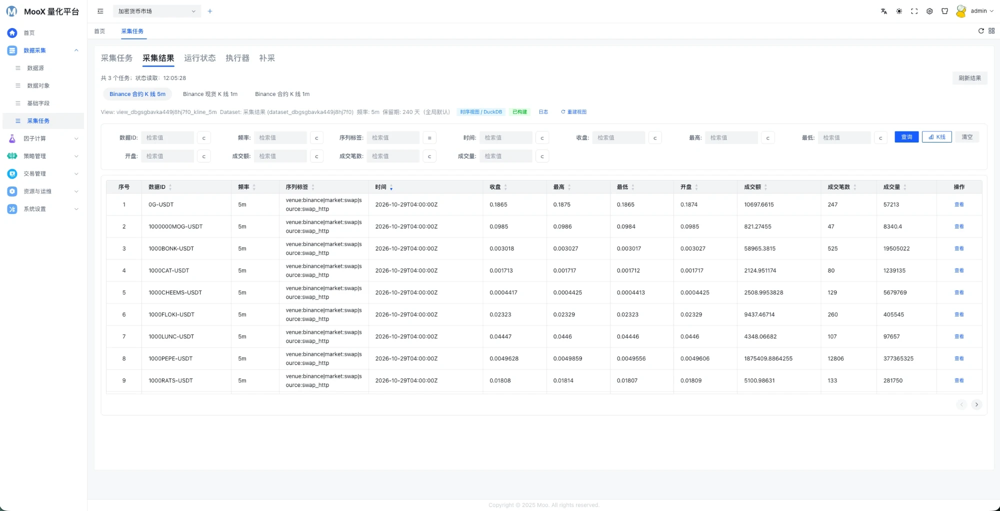
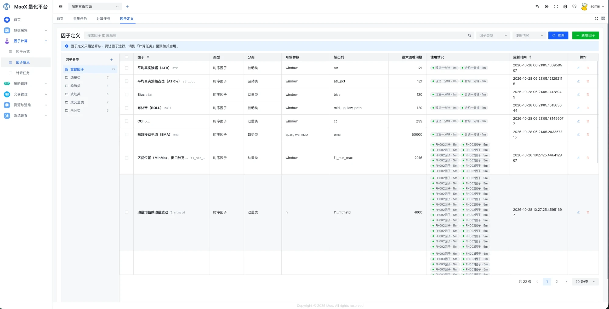
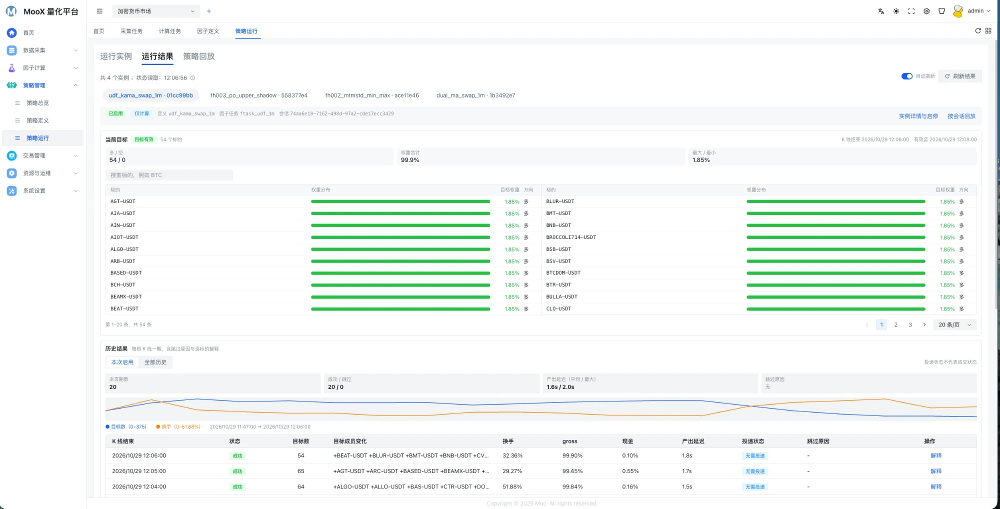
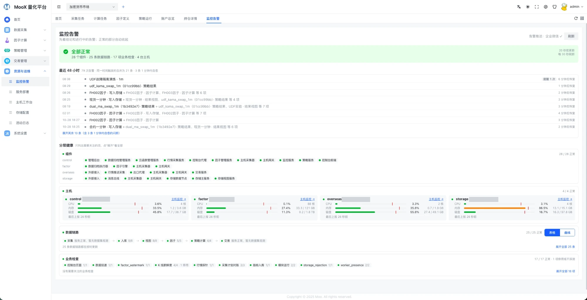
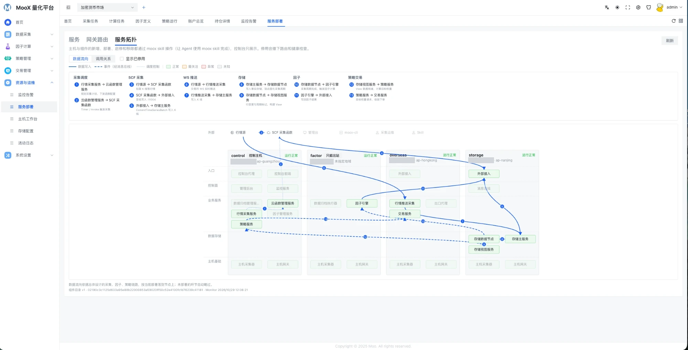

# MooX

[](LICENSE) [](https://github.com/mooyang-code/moox/releases)  

**生产级分布式实时量化平台。** 覆盖行情采集、因子计算、策略决策、实盘交易与监控告警全链路，私有化部署于用户自有服务器，支持由 AI Agent 完成安装与日常运维。

- **实时**：1 分钟 K 线收盘后 **2.5 秒**内完成 522 个永续合约、16 个因子（单标的回看 5 万根 K 线）的计算，并输出策略目标。
- **分布式**：采集、存储、计算与管控分布于多台主机。行情按地域就近采集，境外行情经海外节点接入，云函数按地域横向扩展；计算节点可部署于高算力主机，局域网服务器亦可加入；通过增加主机扩展容量，不受单机 CPU、内存与网络带宽限制。
- **解耦与通用**：同一数据链路同时承载**加密货币、A 股、港股、美股**，各市场相互隔离；采集、存储、因子、策略、交易、监控各模块相互独立，可分别升级、扩容或替换；因子与策略定义与市场无关，可跨市场复用。
- **实盘交易**：策略目标权重自动换算为订单并持续执行至目标持仓，支持组合账户与人工干预；同一策略可在模拟盘验证后切换至实盘。交易接入：Binance、OKX 与模拟盘（实现中），A 股、港股、美股券商（实现中）。
- **高性能**：单期计算覆盖 **2,610 万根 K 线**；包含 **1,960 个子策略**的多因子选币策略，K 线收盘至策略目标产出的中位耗时为 4.64 秒（详见[性能](#性能)）。
- **高可靠**：主机重启、网络中断或上游数据缺失时，计算结果保持正确：缺失数据自动补采与补算，暂停后先追平再恢复，相同输入的重算结果逐位一致；服务间调用全程签名鉴权，配置加密存储。
- **可观测与可运维**：监控覆盖从采集到策略的全部环节；数据延迟或缺失即时告警至企业微信或飞书，管理台首页汇总待处理事项；暂停、恢复、升级、回滚均由单条命令完成。
- **部署轻量**：不依赖 MySQL、Redis、Kafka 等外部数据库与中间件，无需 Docker 或 Kubernetes；每个服务均为独立可执行文件，存储与消息通道内置；升级与回滚通过替换可执行文件完成。
- **易于上手**：由 AI Agent 完成部署与初始化；提供预编译产物，无需本地编译；因子以公式定义，策略以声明式规则配置，上线前支持校验、试算与历史回放；Web 管理台与命令行功能一致。

MooX 为单用户系统：唯一登录用户拥有全部管理权限；登录、会话、请求签名、防重放与配置加密始终启用。

## 性能

测试时间为 2026-10-29，生产环境连续运行 6 小时（02:39～08:39 UTC），三个场景共 794 个周期全部成功，无跳过周期。

**规模**

| 场景 | 周期 | 标的 | 单标的回看 | 参与计算的 K 线 | 因子 | 子策略 |
| --- | --- | ---: | ---: | ---: | ---: | ---: |
| 永续合约多因子 | 1 分钟 | 522 | 50,000 根 | 2,610 万根 | 16 个 | — |
| 轻量因子（含自定义算子） | 1 分钟 | 522 | 400 根 | 20.9 万根 | 3 个 | — |
| 多因子选币策略 | 5 分钟 | 522 | 50,000 根 | 2,610 万根 | 45 个 | 1,960 个 |

**端到端耗时**（K 线收盘至策略目标产出）

| 场景 | 采集入库 | 因子计算 | 策略决策 | 全链路 p50 | 全链路 p95 |
| --- | ---: | ---: | ---: | ---: | ---: |
| 永续合约多因子 | 0.57 秒 | 1.35 秒 | 0.57 秒 | **2.48 秒** | 2.72 秒 |
| 轻量因子（含自定义算子） | 0.56 秒 | 0.52 秒 | 0.51 秒 | **1.61 秒** | 1.90 秒 |
| 多因子选币策略 | 0.69 秒 | 2.69 秒 | 1.28 秒 | **4.64 秒** | 5.44 秒 |

- 永续合约多因子场景包含 EMA、MACD、RSI、布林带、ATR、VWAP 等 14 种因子。
- 分段耗时取中位数。**采集入库**：自 K 线收盘至行情入库并开始因子计算；**因子计算**：读取数据、计算与写回结果；**策略决策**：读取因子结果、规则求值、保存结果与目标权重。
- 测试环境：存储机 4 核 16G、管理台主机 4 核 4G（腾讯云）；因子计算主机 Intel Xeon E5-2696 v4、88 线程、128G 内存（局域网）。行情数据来自 Binance U 本位永续合约。

## 功能

| 环节 | 能力 |
| --- | --- |
| 采集 | 加密货币（Binance 现货、U 本位永续合约）WebSocket 推送与定时拉取；A 股、港股、美股行情接入；缺口自动巡检与补采，多周期 K 线合成，标的上下架自动同步 |
| 存储 | 市场、数据源、标的、标签、数据集与字段的统一元数据管理；行情与因子结果统一存储，按保留策略管理；查询视图可重建；按日 / 月归档为 CSV |
| 因子 | 公式化因子定义（`ts_mean`、`cs_rank`、`ema` 等算子），逐周期实时计算，支持历史补算；支持以 Rust 编写自定义算子 |
| 策略 | 声明式策略规则：截面排序（选股 / 选币）、逐标的信号、分批持仓，统一止损止盈；策略模板与参数表批量生成；逐周期输出目标权重，支持按历史数据逐期回放 |
| 交易 | 目标权重换算为订单并收敛至目标持仓；组合账户、人工干预、模拟盘；Binance、OKX 实盘（实现中）；A 股、港股、美股券商接入（实现中） |
| 监控 | 组件、主机、数据链路与业务检查的分层健康监测；数据集时效告警，推送至企业微信 / 飞书；管理台首页汇总待处理事项 |
| 运维 | 服务调用签名鉴权与方法级授权，配置整体加密；部署、升级、回滚、暂停与恢复、系统重置均提供命令，可由 AI Agent 执行 |

## 设计对比

与常见的开源交易框架不同，MooX 并非嵌入代码的交易库或单机交易机器人，而是分布式部署的完整平台，统一承载数据、计算、执行与运维。

| | MooX | [freqtrade](https://github.com/freqtrade/freqtrade) | [nautilus_trader](https://github.com/nautechsystems/nautilus_trader) | [vn.py](https://github.com/vnpy/vnpy) | [WonderTrader](https://github.com/wondertrader/wondertrader) |
| --- | --- | --- | --- | --- | --- |
| 形态 | 分布式服务集群（多主机协作）+ Web 管理台 + CLI | 单进程交易机器人 | 交易引擎库（Rust 核心、Python 接口） | Python 交易平台（桌面 GUI 与应用模块） | C++ 交易引擎 + Python 封装 |
| 多市场 | 同一平台同时运行加密货币、A 股、港股、美股 | 加密货币 | 多资产，经适配器接入交易所与券商 | 国内期货、股票等，经交易接口接入 | 国内期货、股票等 |
| 数据 | 内置采集、补采、元数据目录与存储，因子与策略直接读取平台数据 | 从交易所下载历史数据至本地文件 | 由使用者自行接入 | 数据库适配与数据服务 | 内置数据落地组件 |
| 因子与策略 | 因子以公式定义，策略以声明式规则配置，均支持上线前校验与试算；输出截面目标权重 | 策略为 Python 类，按交易对生成信号 | 以 Python / Rust 编写事件驱动策略 | 以 Python 编写 CTA、价差等策略 | 以 C++ / Python 编写 CTA、选股、高频等策略 |
| 回测 | 按实盘时序逐期回放（因子 → 策略 → 模拟成交）；不提供向量化回测与参数寻优 | 回测、参数寻优、FreqAI | 回测与实盘共用同一引擎 | 回测模块 | 回测引擎 |
| 运维 | 签名鉴权与方法级授权、配置加密、全链路监控告警；由 Agent 通过 skill 与 CLI 完成部署与管理 | 配置文件、Telegram、FreqUI | 由使用者自建 | GUI | 由使用者自建 |

表中其他框架的描述仅概括其公开定位，具体能力以各项目文档为准。

设计要点：

- **分布式、解耦、通用**：多主机协作，模块之间仅通过标准接口与事件交互，各模块可独立暂停、恢复、升级与扩容；同一平台同时运行多个市场。
- **声明式**：因子与策略以数据而非代码表达，上线前支持校验、试算与回放；同类策略可通过模板与参数表批量生成。
- **面向 Agent**：管理台功能均有对应的命令行入口；skill 定义部署与排障流程，以及需用户确认的操作；密码与密钥仅在用户本机页面输入，不经过 AI。
- **依赖精简**：服务器仅运行 MooX 自身程序，无需单独安装和维护数据库、消息队列或容器环境。
- **弹性采集**：海外节点接收 WebSocket 推送以保证实时性，云函数按地域横向扩展拉取，缺口自动补采。

不适用场景：高频与盘口级交易（最小周期为 1 分钟）；大规模参数寻优类研究。

## 架构

### 数据处理



### 部署



详见 [总体设计](docs/总体设计.md)。

## 前置条件

- **云账号**：云上的自动化操作目前通过腾讯云 API 完成（其他云厂商后续接入）。需创建腾讯云子用户 API 密钥，并授权 `QcloudSCFFullAccess`、`QcloudCOSFullAccess`、`QcloudCLSFullAccess`、`QcloudLighthouseFullAccess`、`QcloudCVMFullAccess`、`QcloudVPCFullAccess` 六个预设策略。
- **服务器**（Linux x86_64；目前须为上述腾讯云账号下的轻量应用服务器或 CVM，用于自动识别地域规格与配置防火墙）：

  | 角色 | 是否必需 | 建议配置 |
  | --- | --- | --- |
  | 存储机 | 必需 | 4 核 16G、100G 磁盘 |
  | 管理台 | 必需，可与存储机或海外机共用 | 2 核 4G |
  | 海外机 | 采集加密货币行情时必需，建议位于香港 | 2 核 4G |
  | 因子机 | 可选，可使用局域网内的 Linux 主机 | 8 核 16G |

- **本机**：macOS、Linux 或 Windows（amd64），可通过 SSH 访问上述服务器。无需安装 Go、Docker 或 Node，发布页提供预编译产物。
- **告警**：企业微信或飞书群机器人的 Webhook 地址。

## 快速开始

将以下提示词发送给可执行命令的 AI Agent（如 Claude Code、Codex）：

```text
请帮我安装并部署 MooX 量化系统：
1. 从 https://github.com/mooyang-code/moox/releases （国内网络用 https://cnb.cool/mooyang-code/moox/-/releases ）
   下载最新版本的 moox-bundle_<版本>_linux_amd64.tar.gz、适合我这台电脑的 moox-cli_<版本>_<系统>_<架构> 和 SHA256SUMS，校验后解压：
   产物包解压出 moox-<版本>/ 目录，把 moox-cli 放进 moox-<版本>/bin/。之后所有命令都在 moox-<版本>/ 目录里执行。
2. 把 moox-<版本>/skills/moox 安装成你的 skill（Claude Code：复制或软链到 ~/.claude/skills/moox），然后读取其中的 SKILL.md，按 references/install.md 执行。
3. 运行 ./bin/moox-cli config init，让我在自己的浏览器里填写云账号密钥、服务器 IP、开通 SSH 免密登录、设置管理员和告警。
   你不要打开、填写或读取这个页面和生成的 moox.toml。
4. 我填完后，按 skill 依次完成部署、初始化和验收，最后告诉我管理台地址和还需要我做的事。
所有写操作先给我预览，删除、清空、重置等操作必须等我确认。
```

Agent 将按照 [安装与初始化](skills/moox/references/install.md) 完成部署；部署完成后，通过浏览器访问 `https://<管理台地址>:9527`。

## 管理台

首页：汇总系统健康、策略目标与持仓、因子计算进度、数据时效、主机资源及待处理事项。



采集结果：按数据集查看已入库的 K 线，支持按标的、时间与价格条件检索，支持触发视图重建。



因子定义：按分类管理因子，展示每个因子的参数、输出列、最大回看周期及引用它的计算任务。



策略运行：展示当前目标权重、每期运行结果、换手率与产出延迟，并提供每期选择结果的逐标的解释。



监控告警：展示最近 48 小时的告警记录，以及组件、主机、数据链路与业务检查的分层健康状态。



服务拓扑：按主机展示数据流与调用关系。主机与部署的增删、启停仅通过 `moox-cli` 执行（由 Agent 借助 skill 完成），管理台仅提供只读视图。



## 文档

- [安装与初始化](skills/moox/references/install.md)、[模块使用说明](skills/moox/references/modules.md)、[管理接口调用示例](skills/moox/references/api-recipes.md)
- [总体设计](docs/总体设计.md)：设计原则、系统全景、部署拓扑、核心数据流、事件与安全
- [部署与运维](docs/部署与运维.md)：初始化、发布、证书、凭据、数据保留与日常检查
- [模块设计](docs/README.md)：各模块的详细设计；[当前实现与限制](docs/实现状态.md)

## 从源码构建

```bash
bash scripts/build/check-build-env.sh --profile all   # 检查 Go（版本见 .go-version）、Docker、Node、pnpm
make build      # 构建默认目标
make test       # Go 与前端测试
make verify     # 提交前的完整检查（与 CI 一致）
scripts/release/build-release.sh vX.Y.Z               # 生成发布产物
```

仓库为 Go Workspace（`go.work`），每个模块与共享包均为独立的 Go module，模块之间仅通过 RPC 与事件交互。构建环境见 [构建手册](docs/构建手册.md)。

## 许可证

[MIT License](LICENSE)：允许自由用于学习、研究及其他用途，允许修改与再分发。基于本项目修改或再分发时，须保留 LICENSE 中的版权与许可声明，并注明来源（https://github.com/mooyang-code/moox）。

本项目不构成任何投资建议。量化交易存在亏损风险，实盘使用前请充分验证，风险自负。
