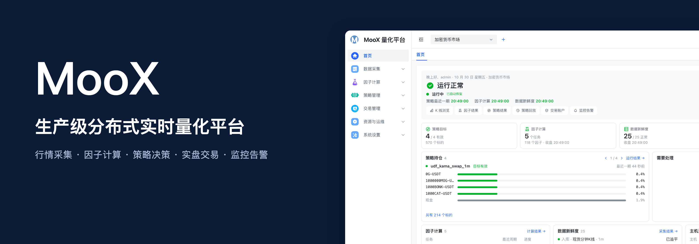
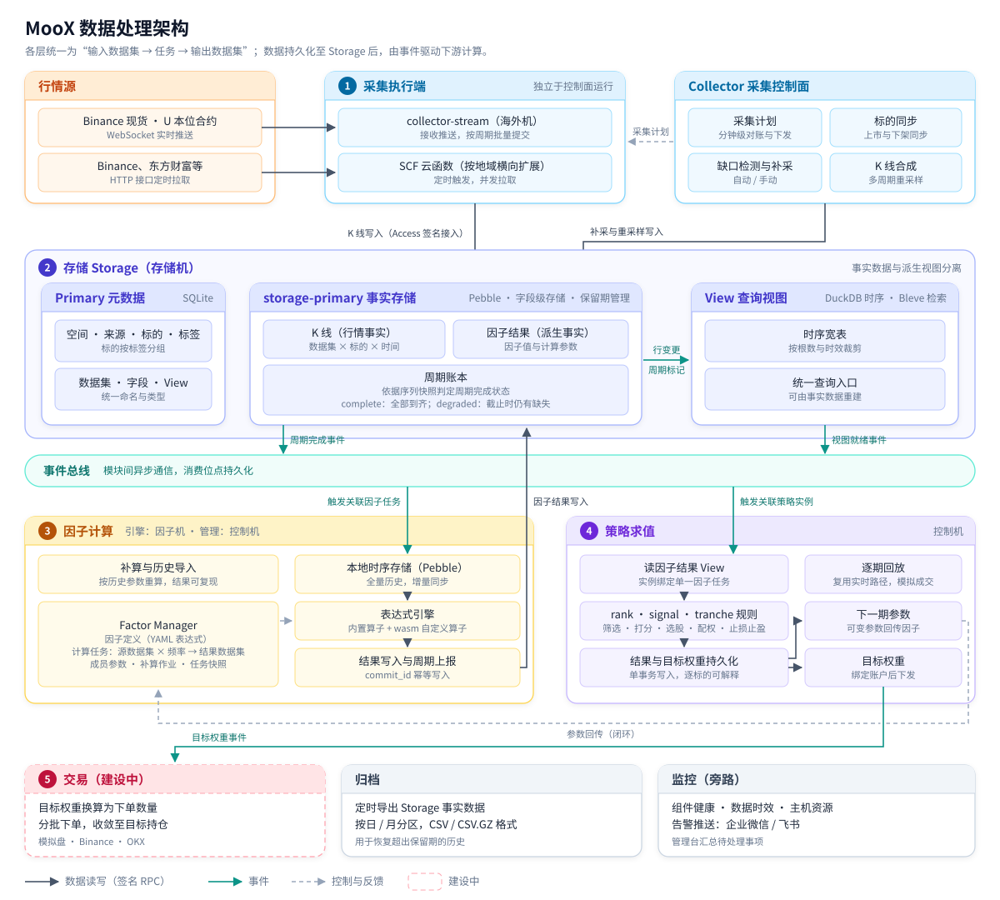
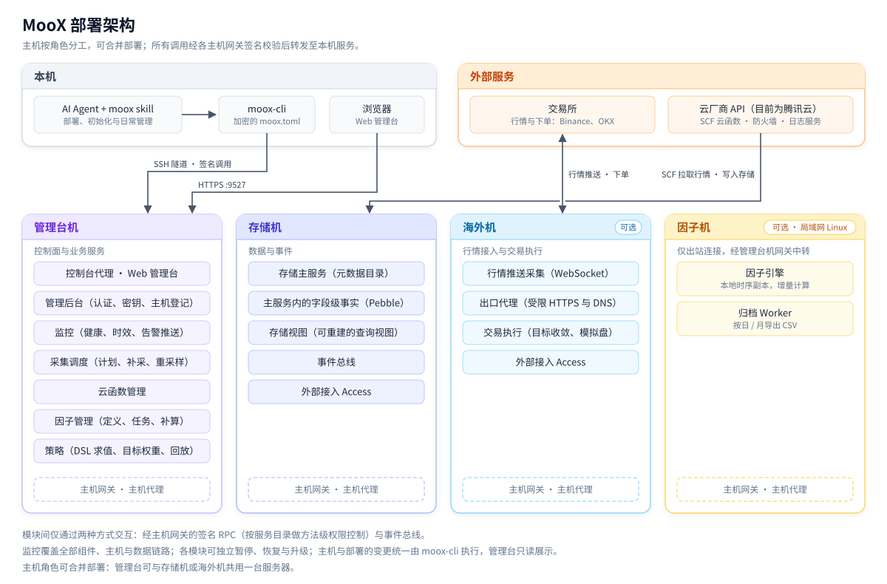
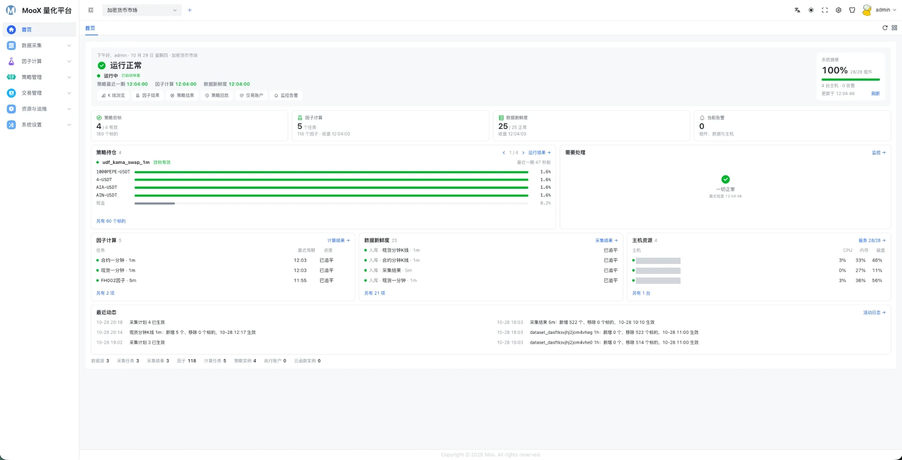
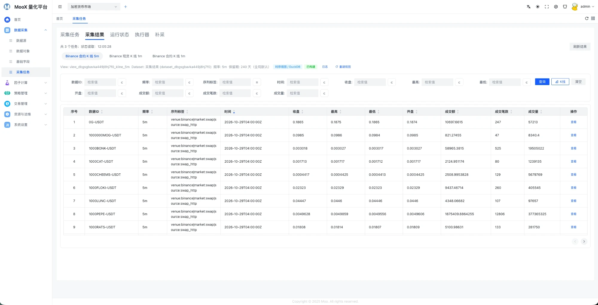
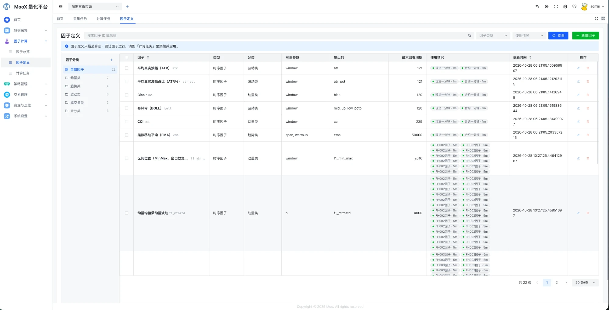
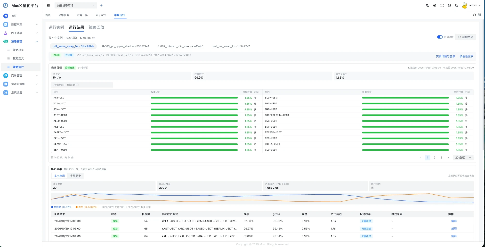
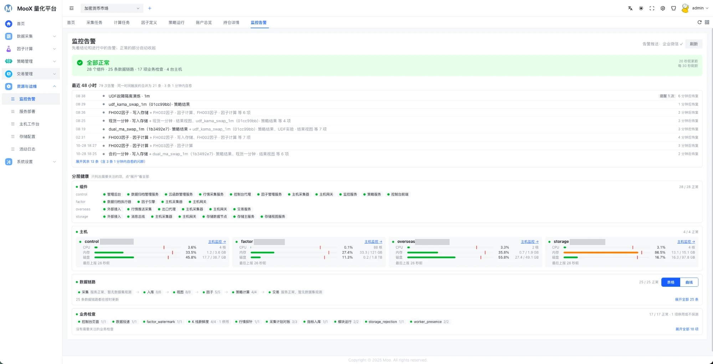
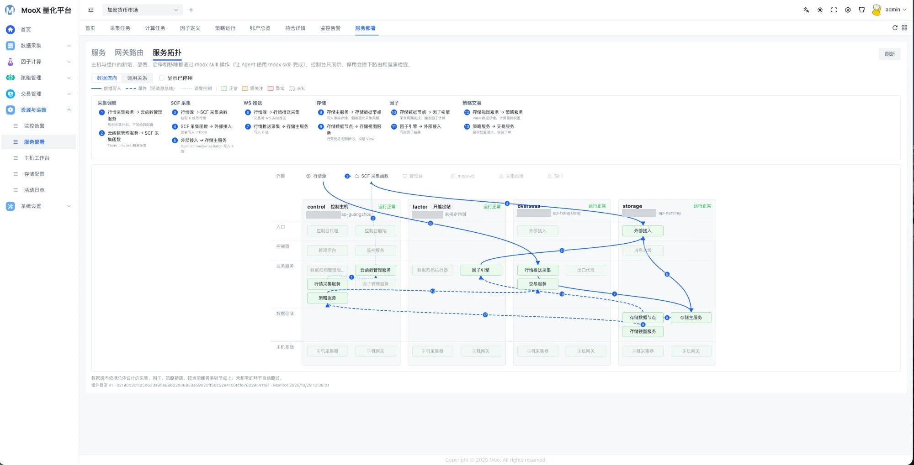

<p align="center">
  
</p>

<p align="center">
  <a href="LICENSE"></a>
  <a href="https://github.com/mooyang-code/moox/releases"></a>
  
  
</p>

<p align="center">
  <a href="#介绍视频">介绍视频</a> · <a href="#安装部署">安装部署</a> · <a href="#核心特性">核心特性</a> · <a href="#性能实测">性能实测</a> · <a href="#管理台">管理台</a> · <a href="#文档">文档</a>
</p>

## 简介

MooX 是自托管的分布式实时量化系统，覆盖行情采集、时序存储、因子计算、策略求值、交易执行与监控告警。系统各模块以独立 Go 进程运行，内置基于 Pebble、DuckDB 与 NATS JetStream 的存储与事件总线，不依赖外部数据库、消息队列或容器环境。

- **统一数据与计算链路**：加密货币、A 股、港股、美股共用同一套采集、存储、因子与策略框架，按市场空间隔离数据与交易日历。
- **低延迟截面计算**：生产环境下 522 个永续合约、16 个因子（单标的回看 50,000 根 K 线）的 1 分钟任务，从 K 线收盘到策略计算完成端到端耗时约 2.5 秒。
- **双端交互与 Agent 运维**：提供功能对齐的 Web 管理台与 `moox-cli` 命令行工具，内置 Agent Skill 支持自动化部署、初始化与日常巡检。

---

## 介绍视频

https://github.com/user-attachments/assets/15d26aac-b36c-480d-bb44-db1a1dadb400

若 GitHub 视频加载缓慢，可访问[备用播放页](https://mooyang-code.github.io/moox/video.html)。

---

## 安装部署

系统提供预编译发布包与内置 Agent Skill。将以下提示词发送给支持命令执行的 AI Agent（如 Claude Code、Codex），即可引导完成配置录入、多机部署与初始化（首次部署含配置填写约需 30 分钟）：

```text
请帮我安装并部署 MooX 量化系统：
1. 从 https://github.com/mooyang-code/moox/releases （国内网络用 https://cnb.cool/mooyang-code/moox/-/releases ）
   下载最新版本的 moox-bundle_<版本>_linux_amd64.tar.gz、适合我这台电脑的 moox-cli_<版本>_<系统>_<架构> 和 SHA256SUMS，校验后解压：
   产物包解压出 moox-<版本>/ 目录，把 moox-cli 放进 moox-<版本>/bin/。之后所有命令都在 moox-<版本>/ 目录里执行。
2. 把 moox-<版本>/skills/moox 安装成你的 skill（Claude Code：复制或软链到 ~/.claude/skills/moox），然后读取其中的 SKILL.md，按 references/install.md 执行。
3. 运行 ./bin/moox-cli config init，让我在自己的浏览器里填写云账号密钥、服务器 IP、开通 SSH 免密登录、设置管理员和告警。
   你不要打开、填写或读取这个页面和生成的 moox.toml。
4. 我填完后，问我要启动哪个空间，按 skill 运行 setup install 完成部署、初始化、启动和验收，最后告诉我管理台地址和还需要我做的事。
所有写操作先给我预览，删除、清空、重置等操作必须等我确认。
```

Agent 会按 [安装与初始化](skills/moox/references/install.md) 执行部署流程。部署完成后，可通过浏览器访问 `https://<管理台地址>:9527`。

### 环境要求

- **云账号**：云资源编排目前基于腾讯云 API 实现。需创建腾讯云子用户 API 密钥，并授予 `QcloudSCFFullAccess`、`QcloudCOSFullAccess`、`QcloudCLSFullAccess`、`QcloudLighthouseFullAccess`、`QcloudCVMFullAccess`、`QcloudVPCFullAccess` 六项策略。

- **目标服务器**（Linux `x86_64`；控制机、存储机与海外机需为上述腾讯云账号下的轻量应用服务器或 CVM，以便自动识别地域规格并配置防火墙）：

  | 角色 | 是否必需 | 建议配置 |
  | --- | --- | --- |
  | 存储机 | 必需 | 4 核 16G、100G 磁盘 |
  | 管理台 | 必需，可与存储机或海外机共用 | 2 核 4G |
  | 海外机 | 采集加密货币行情时必需，建议位于香港 | 2 核 4G |
  | 因子机 | 可选，支持接入局域网或本地 Linux 主机 | 8 核 16G |

- **操作本机**：macOS 或 Linux，需具备到目标服务器的 SSH 连通性（Windows 目前仅支持运行只读 CLI 命令，不支持执行部署）。本机无需安装 Go、Docker 或 Node.js。

- **告警渠道（可选）**：企业微信、飞书、钉钉群机器人的 Webhook 地址，或任意接收告警的公网 HTTPS 地址（通用 Webhook），也可在部署后通过管理台配置。

---

## 核心特性

### 采集与存储

- **多模式行情采集**：支持常驻 WebSocket 流式接收（加密货币默认）与无状态云函数（SCF）定时拉取，控制面负责任务分片、序列快照登记与周期对账，执行端重启不影响采集计划。
- **缺口检测与自动补采**：以 Storage DataNode 作为周期完成的唯一权威；当上游延迟或中断导致缺口时，自动触发补采并通知下游沿连续水位补算。
- **事实与视图分离**：DataNode 基于 Pebble 持久化字段级时序事实并通过 Outbox 发布变更；View 节点基于 DuckDB 与 Bleve 构建可随时重建的查询索引。

### 因子与策略

- **表达式与 Wasm 因子引擎**：因子使用公式定义，编译期自动推导类型、输入输出列与回看窗口，并支持通过 WebAssembly（`.udfpkg`）加载自定义算子。计算节点在本地维护连续时序网格与内存滑动窗口，仅需出站网络即可接入集群。
- **声明式策略与参数闭环**：策略通过声明式 DSL 定义过滤、打分、截面选股、配权、信号与分批持仓规则，输出组合账户目标权重与逐标的解释；支持策略在求值后向关联因子任务提交下一期可变参数，并通过系统列 `__params` 完整记录每期实际参数。
- **实盘时序回放**：支持按历史时间轴逐期回放（因子计算 → 策略求值 → 纸面账本撮合），与实时运行复用同一套计算路径，上线前无需维护独立的回测代码。

### 交易、架构与运维

- **目标持仓收敛**：交易模块校验策略会话与目标时效，按组合账户权益将目标权重换算为具体委托并逐步收敛至目标持仓，支持模拟盘验证与人工干预（接入状态见[支持的市场与接口](#支持的市场与接口)）。
- **单二进制无外部中间件**：各模块独立编译为单一可执行文件，按职责内嵌 SQLite、Pebble、DuckDB、NATS JetStream 与 Caddy，无需维护外部数据库、消息中间件或 Kubernetes 集群。
- **统一生命周期与栅栏恢复**：采集、因子、策略、交易共用状态机；系统级暂停按“下游到上游”顺序停机，恢复时先追平采集缺口与因子水位，待全部有副作用模块追平后再统一放行交易。
- **全链路监控与安全基线**：内置进程探活、主机资源、数据集新鲜度与 K 线完整性检查，异常实时推送至企业微信、飞书、钉钉或通用 Webhook；全链路启用请求签名、私有 CA TLS 与方法级 ACL（详见[安全](#安全)）。

---

## 性能实测

基准测试于 2026-10-29 在生产环境连续运行 6 小时（02:39～08:39 UTC），覆盖三个场景共 794 个周期，全部按期完成，无跳过周期。

**计算规模**

| 场景 | 周期 | 标的 | 单标的回看 | 参与计算的 K 线 | 因子 | 子策略 |
| --- | --- | ---: | ---: | ---: | ---: | ---: |
| 轻量因子（含自定义算子） | 1 分钟 | 522 | 400 根 | 20.9 万根 | 3 个 | — |
| 永续合约多因子 | 1 分钟 | 522 | 50,000 根 | 2,610 万根 | 16 个 | — |
| 多因子选币策略 | 5 分钟 | 522 | 50,000 根 | 2,610 万根 | 45 个 | 1,960 个 |

**端到端耗时**（K 线收盘至策略计算完成）

| 场景 | 采集入库 | 因子计算 | 策略决策 | 全链路总耗时 p50 | 全链路总耗时 p95 |
| --- | ---: | ---: | ---: | ---: | ---: |
| 轻量因子（含自定义算子） | 0.56 秒 | 0.52 秒 | 0.51 秒 | **1.61 秒** | 1.90 秒 |
| 永续合约多因子 | 0.57 秒 | 1.35 秒 | 0.57 秒 | **2.48 秒** | 2.72 秒 |
| 多因子选币策略 | 0.69 秒 | 2.69 秒 | 1.28 秒 | **4.64 秒** | 5.44 秒 |

- **测试负载**：永续合约多因子场景包含 EMA、MACD、RSI、布林带、ATR、VWAP 等 14 类因子。
- **阶段定义**（分段耗时取中位数）：**采集入库**为 K 线收盘至行情入库并触发因子计算；**因子计算**为读取窗口、执行计算并写回结果数据集；**策略决策**为读取因子视图、执行规则求值、落库结果与目标权重。
- **测试环境**：存储机 4 核 16G、管理台主机 4 核 4G（腾讯云）；因子计算主机为 Intel Xeon E5-2696 v4（88 线程、128G 内存，局域网接入）。行情源为 Binance U 本位永续合约。

---

## 架构

### 数据处理



### 部署



架构细节见 [总体设计](docs/总体设计.md)。

---

## 支持的市场与接口

**行情源**

- **加密货币**：Binance 现货、U 本位永续合约（支持 WebSocket 推送与定时拉取）
- **A 股、港股、美股**：东方财富、新浪、腾讯、通达信等行情源（通过 SCF 云函数定时拉取）

**交易执行**

- 模拟盘（实现中）
- Binance、OKX（实现中）
- A 股、港股、美股券商（实现中）

**基础设施与云平台**

- **腾讯云**：支持轻量应用服务器、CVM、SCF 云函数与 CLS 日志服务的自动化编排；自动部署要求控制机、存储机与海外机位于腾讯云（因子机可使用局域网或本地 Linux 主机）。
- **其他云平台 / 自建环境**：自动化编排适配中；非腾讯云主机可参考 [部署与运维](docs/部署与运维.md) 手动初始化各模块配置。

---

## 管理台

**首页**：只回答“有没有问题、去哪处理”：待处理事项、策略目标与持仓、因子计算进度，以及数据时效和主机里不正常的项。



**采集结果**：按数据集浏览已入库的 K 线，支持按标的、时间范围与价格条件检索。



**因子定义**：按分类管理因子表达式，展示参数、输出列、最大回看周期及关联的计算任务。



**策略运行**：展示当前目标权重、每期运行记录、换手率与产出延迟，并提供选股结果的逐标的解释明细。



**监控告警**：展示最近 48 小时的告警记录，以及组件、主机、数据链路与业务检查的分层健康状态。



**服务拓扑**：按主机展示数据流向与调用关系。主机与部署单元的增删、启停统一通过 `moox-cli` 执行，管理台提供只读视图。



---

## 设计对比

MooX 定位于多机协作的完整运行系统，侧重分钟级及以上周期的多标的截面计算与全链路运维，而非单机交易机器人或嵌入式回测库。

| 维度 | MooX | [freqtrade](https://github.com/freqtrade/freqtrade) | [nautilus_trader](https://github.com/nautechsystems/nautilus_trader) | [vn.py](https://github.com/vnpy/vnpy) | [WonderTrader](https://github.com/wondertrader/wondertrader) |
| --- | --- | --- | --- | --- | --- |
| 系统形态 | 分布式服务集群 + Web 管理台 + CLI | 单进程交易机器人 | 交易引擎库（Rust 核心 + Python 绑定） | Python 交易框架（桌面 GUI 与应用模块） | C++ 交易引擎 + Python 封装 |
| 市场覆盖 | 同一系统同时运行加密货币、A 股、港股、美股 | 加密货币 | 多资产，通过适配器接入交易所与券商 | 国内期货、股票等，通过交易接口接入 | 国内期货、股票等 |
| 数据链路 | 内置分布式采集、自动补采、时序存储与查询视图 | 下载交易所历史数据至本地文件 | 由使用者自行接入 | 数据库适配与数据服务 | 内置数据落地组件 |
| 因子与策略 | 表达式/Wasm 因子 + 声明式策略 DSL，输出截面目标权重 | Python 策略类，按交易对生成信号 | Python / Rust 编写事件驱动策略 | Python 编写 CTA、价差等策略 | C++ / Python 编写 CTA、选股、高频等策略 |
| 回测方式 | 按实盘时序逐期回放（因子 → 策略 → 模拟成交），不做向量化回测与参数寻优 | 历史回测、参数寻优、FreqAI | 回测与实盘共用事件驱动引擎 | 回测模块 | 回测引擎 |
| 部署与运维 | 服务间签名鉴权、配置加密、全链路监控告警；支持 CLI 与 Agent 自动化运维 | 配置文件、Telegram、FreqUI | 由使用者自建 | 桌面 GUI | 由使用者自建 |

表中其他项目仅概括其常见公开定位，具体能力以各项目官方文档为准。

**边界与不适用场景**：高频及盘口（Tick / OrderBook）级交易（系统最小周期为 1 分钟）；大规模向量化回测与参数网格寻优。

---

## 安全

### 运行时

| 维度 | 机制 |
| --- | --- |
| 登录与会话 | 一次性盐值挑战 + bcrypt 密码哈希；登录后签发 24 小时会话，管理请求均附带含 nonce 的会话 HMAC 以防重放 |
| 服务间调用 | 经主机网关转发，对调用方身份、目标主机、请求体摘要与时间戳计算 HMAC 签名并按原始字节校验防重放；跨主机通信叠加私有 CA 签发的 TLS |
| 访问控制 | 由网关 ACL 实施方法级授权；外部调用方（SCF、因子机、Skill）统一经 Access 接入，按白名单限制可调用的 RPC 方法 |
| 事件总线 | 启用 TLS 与按角色隔离的访问凭据，支持通过 CLI 生成与轮换 |
| 密钥与配置 | 部署清单 `moox.toml` 加密存储，仅通过 CLI 读写；交易所等外部凭据集中存储于 Admin 密钥表，由 Trade 按 ID 单条读取 |
| 管理台入口 | 仅使用内部 CA 签发的 TLS 证书；首次访问可从管理台下载根证书并核对指纹 |

设计细节见 [总体设计](docs/总体设计.md)“服务调用与安全”一节。

### 代码与依赖

| 维度 | 措施 |
| --- | --- |
| 依赖漏洞扫描 | Go 依赖通过 [govulncheck](https://go.dev/doc/security/vuln/) 进行符号级可达性扫描，前端依赖通过 `pnpm audit` 检查；2026-11-03 起 Go 可达漏洞与前端已知漏洞均为 0 |
| 工具链锁定 | Go 版本由 `.go-version` 锁定并随安全更新升级（当前为 1.27.3）；Linux 编译镜像中的 Go 安装包校验 SHA-256，构建脚本拒绝不一致的工具链版本 |
| 模块独立依赖 | 各模块通过独立的 `go.mod` 维护依赖，不依赖工作区隐式合并；存储引擎等核心依赖在 `go.work` 中固定版本，防止被传递依赖升级顺带抬高 |
| 密钥防泄露 | 每次合并请求在 CNB 与 GitHub CI 中分别执行 gitleaks 增量提交扫描；配置默认拒绝，例外规则须注明原因 |
| 平台安全扫描 | 合并请求自动触发 CNB 代码安全扫描（覆盖漏洞、敏感信息、许可证与 SBOM） |
| 持续集成验证 | 合并前执行 Go 全量测试、前端测试、构建与静态检查；合入主分支后在自建 Runner 上执行二次复核检查 |

已知说明：控制台代理内嵌的 Caddy 经 `smallstep` 间接依赖 `go-jose` v3（该主版本暂无上游修复版），受影响符号在实际代码中不可达，待上游迁移至 v4 后跟进升级。

---

## 文档

- [安装与初始化](skills/moox/references/install.md)、[模块使用说明](skills/moox/references/modules.md)、[管理接口调用示例](skills/moox/references/api-recipes.md)
- [总体设计](docs/总体设计.md)：设计原则、系统全景、部署拓扑、核心数据流、事件与安全
- [部署与运维](docs/部署与运维.md)：初始化、发布、证书、凭据、数据保留与日常检查
- [模块设计](docs/README.md)：各模块的详细设计；[当前实现与限制](docs/实现状态.md)

## 从源码构建

```bash
bash scripts/build/check-build-env.sh --profile all   # 检查 Go（版本见 .go-version）、Docker、Node、pnpm
make build      # 构建默认目标
make test       # Go 与前端测试
make verify     # 提交前的完整检查（与 CI 一致）
scripts/release/build-release.sh vX.Y.Z               # 生成发布产物
```

仓库为 Go Workspace（`go.work`），每个模块与共享包均为独立的 Go module，模块之间仅通过 RPC 与事件交互。构建环境见 [构建手册](docs/构建手册.md)。

## 许可证

[MIT License](LICENSE)：允许自由用于学习、研究及其他用途，允许修改与再分发。基于本项目修改或再分发时，须保留 LICENSE 中的版权与许可声明，并注明来源（https://github.com/mooyang-code/moox）。

本项目不构成任何投资建议。量化交易存在亏损风险，实盘使用前请充分验证，风险自负。
