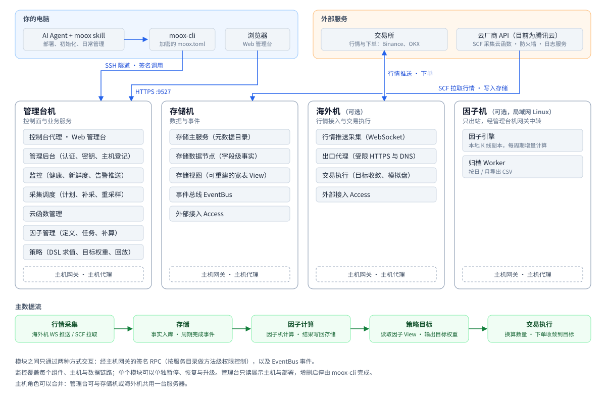

# MooX

面向个人的自托管量化系统：行情采集、数据存储、因子计算、策略目标、交易执行和全链路监控，
提供 Web 管理台和 `moox-cli` 命令行。**装上 MooX 的 Agent skill，部署、初始化和日常管理都可以交给 AI Agent 完成。**

MooX 是单用户系统：唯一的登录用户拥有全部管理能力；登录、会话、请求签名、防重放和配置加密始终开启。部署在你自己的云服务器上；需要调用云厂商接口的操作（识别服务器、开放防火墙端口、部署采集云函数、日志服务）目前对接腾讯云 API，其他云厂商后续接入。

## 功能

| 环节 | 能做什么 |
| --- | --- |
| 采集 | 币安现货、合约等行情：海外机经 WebSocket 接收推送，或用腾讯云 SCF 云函数定时拉取；自动巡检缺口并补采，K 线合成更大周期，按小时同步交易所上下架的标的 |
| 存储 | 元数据目录（空间、数据来源、标的、标签、数据集、字段）；字段级事实存储（Pebble）；面向查询、可随时重建的宽表 View（DuckDB）；按日 / 月归档成 CSV |
| 因子 | 用 YAML 表达式写因子（`ts_mean`、`cs_rank`、`ema` 等算子），按“源数据集 + 频率”组织计算任务，每个周期增量计算；支持历史补算，DSL 写不出的算法可以用 Rust 写成 wasm 自定义算子 |
| 策略 | 声明式策略 DSL：`rank`（截面排序选股 / 选币）、`signal`（逐标的信号）、`tranche`（分批持仓）三类规则，统一的止损止盈，策略模板与参数表；按周期输出目标权重，可用历史数据逐期回放 |
| 交易 | 把策略的目标权重换算成数量并下单收敛，组合账户、人工干预、模拟盘（交易模块仍在完善中） |
| 监控 | 组件与主机健康、每个数据集的新鲜度、告警推送到企业微信 / 飞书；管理台首页汇总“需要处理”的事项 |
| 运维 | 每台主机一个签名网关，所有调用按服务目录做方法级权限控制；配置整份加密；部署、升级、回滚、暂停与恢复、系统重置都有命令 |

## 设计上的不同

MooX 和常见的开源交易框架定位不同：它不是一个嵌进代码的交易库，而是一套跑在几台服务器上的完整系统，数据、计算、执行和运维放在一起。

| | MooX | [freqtrade](https://github.com/freqtrade/freqtrade) | [nautilus_trader](https://github.com/nautechsystems/nautilus_trader) | [vn.py](https://github.com/vnpy/vnpy) | [WonderTrader](https://github.com/wondertrader/wondertrader) |
| --- | --- | --- | --- | --- | --- |
| 形态 | 多主机的服务系统 + Web 管理台 + CLI | 单进程交易机器人 | 交易引擎库（Rust 核心、Python 接口） | Python 交易平台（桌面 GUI 与各类应用模块） | C++ 交易引擎 + Python 外壳 |
| 数据 | 自带采集、补采、元数据目录和存储，因子与策略直接读系统里的数据 | 从交易所下载历史数据到本地文件 | 由使用者接入数据 | 数据库适配与数据服务 | 自带数据落地组件 |
| 因子与策略 | 因子是 YAML 表达式，策略是声明式 DSL，都可以先校验、试算再上线；输出截面目标权重 | 策略是 Python 类，逐交易对产生信号 | 用 Python / Rust 写事件驱动策略 | 用 Python 写 CTA、价差等策略 | 用 C++ / Python 写 CTA、选股、高频等策略 |
| 回测 | 按实盘时序逐期回放（因子 → 策略 → 纸面成交），不是向量化回测，也没有参数寻优 | 回测、参数寻优、FreqAI | 回测与实盘同一套引擎 | 回测模块 | 回测引擎 |
| 运维 | 签名网关与方法级权限、加密配置、全链路监控告警，由 Agent 通过 skill 和 CLI 完成部署与管理 | 配置文件、Telegram、FreqUI | 由使用者自建 | GUI | 由使用者自建 |

表中其他框架的描述只概括其公开定位，具体能力以各项目文档为准。

MooX 的特点：

- **一体化**：采集 → 存储 → 因子 → 策略 → 交易 → 监控在一个系统里，模块之间只通过签名 RPC 和事件总线交互，单个模块可以单独暂停、恢复和升级。
- **声明式**：因子和策略是数据而不是代码，上线前能校验、试算和回放；同一类策略写个模板、换参数表即可批量生成。
- **为 Agent 设计**：管理台的功能在命令行里都有对应入口，skill 告诉 Agent 怎么部署、怎么排查、哪些操作要先问用户；密码与密钥只在用户本机的页面里输入，不经过 AI。
- **弹性采集**：海外机收 WebSocket 推送保证实时性，云函数按地域横向扩展拉取，自动补采缺口。

不适合的场景：高频与盘口级交易（最小周期 1 分钟）、需要大规模参数寻优的研究；交易所目前接入 Binance、OKX 和模拟盘，行情源目前是币安与东方财富。

## 架构



详见 [总体设计](docs/总体设计.md)。

## 前置条件

- **云账号**：云上的自动化操作目前通过腾讯云 API 完成（其他云厂商后续接入）。建一个腾讯云子用户的 API 密钥，授权 `QcloudSCFFullAccess`、`QcloudCOSFullAccess`、`QcloudCLSFullAccess`、`QcloudLighthouseFullAccess`、`QcloudCVMFullAccess`、`QcloudVPCFullAccess` 六个预设策略。
- **服务器**（Linux x86_64；目前需要是上面这个腾讯云账号下的轻量应用服务器或 CVM，以便自动识别地域规格、开放防火墙）：

  | 角色 | 是否必需 | 建议配置 |
  | --- | --- | --- |
  | 存储机 | 必需 | 4 核 16G、100G 磁盘 |
  | 管理台 | 必需，可与存储机或海外机共用 | 2 核 4G |
  | 海外机 | 采集加密货币行情时需要，建议香港 | 2 核 4G |
  | 因子机 | 可选，可以是家里或局域网的 Linux 机器 | 8 核 16G |

- **本机**：macOS、Linux 或 Windows（amd64），能 SSH 到这些服务器。**不需要**安装 Go、Docker 或 Node：发布页提供编译好的产物。
- **告警**：企业微信或飞书群机器人的 Webhook 地址。

## 快速开始

把下面这段话发给你的 Agent（Claude Code、Codex 等能执行命令的 Agent）：

```text
请帮我安装并部署 MooX 量化系统：
1. 从 https://github.com/mooyang-code/moox/releases （国内网络用 https://cnb.cool/mooyang-code/moox/-/releases ）
   下载最新版本的 moox-bundle_<版本>_linux_amd64.tar.gz、适合我这台电脑的 moox-cli_<版本>_<系统>_<架构> 和 SHA256SUMS，校验后解压：
   产物包解压出 moox-<版本>/ 目录，把 moox-cli 放进 moox-<版本>/bin/。之后所有命令都在 moox-<版本>/ 目录里执行。
2. 把 moox-<版本>/skills/moox 安装成你的 skill（Claude Code：复制或软链到 ~/.claude/skills/moox），然后读取其中的 SKILL.md，按 references/install.md 执行。
3. 运行 ./bin/moox-cli config init，让我在自己的浏览器里填写云账号密钥、服务器 IP、开通 SSH 免密登录、设置管理员和告警。
   你不要打开、填写或读取这个页面和生成的 moox.toml。
4. 我填完后，按 skill 依次完成部署、初始化和验收，最后告诉我管理台地址和还需要我做的事。
所有写操作先给我预览，删除、清空、重置等操作必须等我确认。
```

Agent 会按 [安装与初始化](skills/moox/references/install.md) 逐步完成，部署完成后用浏览器打开 `https://<管理台地址>:9527`。

## 管理台

首页汇总系统健康、策略目标与持仓、因子计算进度、数据新鲜度、主机资源和“需要处理”的事项：


采集结果：按数据集查看入库的 K 线，支持按标的、时间、价格条件检索，并可触发重建 View：


因子定义：按分类管理因子，查看每个因子的参数、输出列、最大回看周期和被哪些计算任务使用：


策略运行：当前目标权重、每期运行结果、换手与产出延迟，可以直接解释某一期为什么选了这些标的：


监控告警：最近 48 小时的告警经过，以及组件、主机、数据链路和业务检查的分层健康：


服务拓扑：数据流与调用关系按主机展示；机器和部署的增删启停只通过 `moox-cli`（Agent 使用 skill 完成），管理台只读展示：


## 文档

- [安装与初始化](skills/moox/references/install.md)、[各模块怎么用](skills/moox/references/modules.md)、[管理接口调用配方](skills/moox/references/api-recipes.md)
- [总体设计](docs/总体设计.md)：设计原则、系统全景、部署拓扑、核心数据流、事件与安全
- [部署与运维](docs/部署与运维.md)：初始化、发布、证书、凭据、数据保留与日常检查
- [模块设计](docs/README.md)：各模块的详细设计；[当前实现与限制](docs/实现状态.md)

## 从源码构建

```bash
bash scripts/build/check-build-env.sh --profile all   # 检查 Go（版本见 .go-version）、Docker、Node、pnpm
make build      # 构建默认目标
make test       # Go 与前端测试
make verify     # 提交前的完整检查（与 CI 相同）
scripts/release/build-release.sh vX.Y.Z               # 生成发布产物
```

仓库是 Go Workspace（`go.work`），每个模块、共享包都是独立的 Go module；模块之间只通过 RPC 和事件交互。构建环境见 [构建手册](docs/构建手册.md)。

## 许可证

[MIT License](LICENSE)：可以自由用于学习、研究和其他用途，可以修改和再分发。基于本项目修改或再分发时，
请保留 LICENSE 中的版权与许可声明，并注明来源（https://github.com/mooyang-code/moox）。

本项目不构成任何投资建议。量化交易有亏损风险，实盘使用前请充分验证，风险自负。
